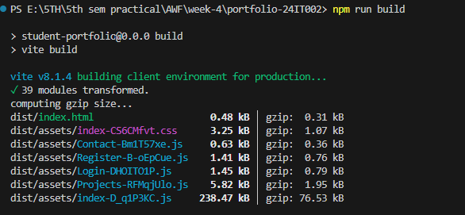
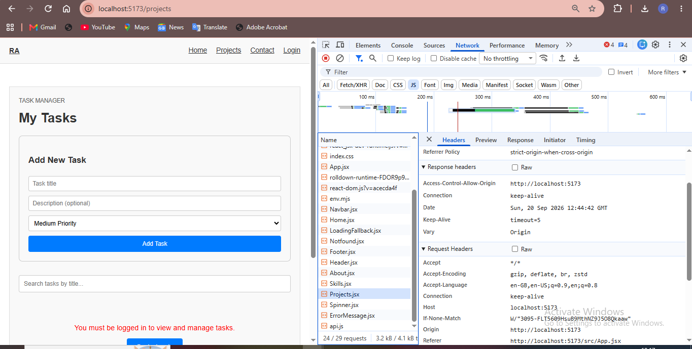
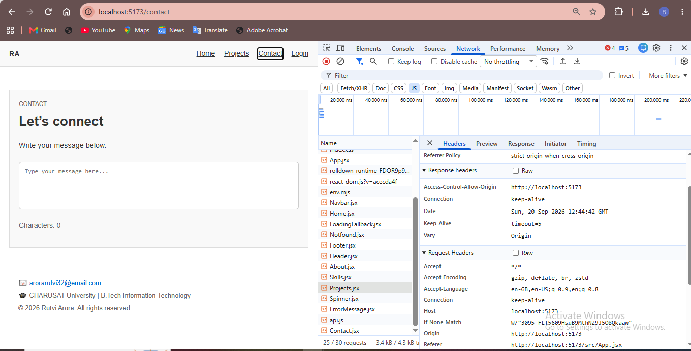
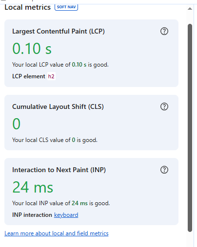

# Portfolio - Practical Progressions: React, Routing, API & Performance Optimization

**Course:** Advanced Web Development Frameworks (ITUE301)  
**Semester:** 5th  

---

## Practical Objectives

This project is a progressive student portfolio built with React and Vite. It covers the following practicals:
1. **Component Architecture**: Building a responsive layout with independent, reusable components.
2. **State Management & Routing**: Creating a multi-route application (Home, Projects, Contact, Login, Register).
3. **API Integration**: Consuming a REST API and handling asynchronous data with loading and error states.
4. **Practical 8: Frontend Performance Optimization**: Implementing route-based lazy loading and code splitting.

---

## Practical 8 — Lazy Loading and Code Splitting

### Objective
Optimize the React frontend application by implementing route-based lazy loading and code splitting using `React.lazy()` and `<Suspense>`. This ensures non-initial route JavaScript bundles (chunks) are loaded on-demand only when a user navigates to those specific routes, minimizing the initial JavaScript payload and accelerating initial page render.

### Implementation Details
- **Dynamic Imports with `React.lazy()`**: Converted static page imports (`Projects`, `Contact`, `Login`, `Register`) to dynamic `import()` statements so that Vite bundles them into individual split chunks.
- **`<Suspense>` Boundary**: Wrapped the `<Routes>` block inside a `<Suspense>` component configured with a dedicated fallback (`<LoadingFallback />`) matching the application aesthetic.
- **Initial Route Strategy**: `Home` remains statically imported because it serves as the critical entry landing route (`/`). Keeping `Home` in the initial bundle ensures the landing view renders immediately without an extra round-trip or suspense flash, while offloading all subsequent routes (`Projects`, `Contact`, `Login`, `Register`) into separate on-demand chunks.

#### Relevant Code Snippet (`src/App.jsx`)
```jsx
import { lazy, Suspense } from 'react';
import { Routes, Route } from 'react-router-dom';
import Navbar from './components/Navbar';
import Home from './components/Home';
import LoadingFallback from './components/LoadingFallback';
import Notfound from './pages/Notfound';
import Footer from './components/Footer';

// Lazy loaded route components (Code Splitting)
const Projects = lazy(() => import('./components/Projects'));
const Contact = lazy(() => import('./components/Contact'));
const Login = lazy(() => import('./components/Login'));
const Register = lazy(() => import('./components/Register'));

function App() {
  return (
    <div id="top">
      <Navbar />
      <div className="page-shell">
        <Suspense fallback={<LoadingFallback />}>
          <Routes>
            <Route path="/" element={<Home />} />
            <Route path="/projects" element={<Projects />} />
            <Route path="/contact" element={<Contact />} />
            <Route path="/login" element={<Login />} />
            <Route path="/register" element={<Register />} />
            <Route path="*" element={<Notfound />} />
          </Routes>
        </Suspense>

        <Footer email="arorarutvi32@email.com" />
      </div>
    </div>
  );
}

export default App;
```

#### Loading Fallback Component (`src/components/LoadingFallback.jsx`)
```jsx
function LoadingFallback() {
  return (
    <div style={{
      display: 'flex',
      flexDirection: 'column',
      alignItems: 'center',
      justifyContent: 'center',
      minHeight: '260px',
      padding: '30px',
      margin: '20px 0',
      background: '#f9f9f9',
      border: '1px solid #ddd',
      borderRadius: '6px'
    }}>
      <div style={{
        width: '36px',
        height: '36px',
        border: '3px solid #e0e0e0',
        borderTopColor: '#0066cc',
        borderRadius: '50%',
        animation: 'spin 0.8s linear infinite',
        marginBottom: '15px'
      }} />
      <p style={{ margin: 0, fontSize: '1rem', color: '#555', fontWeight: 500 }}>
        Loading component...
      </p>
    </div>
  );
}

export default LoadingFallback;
```

---

### Build & Chunk Analysis

#### Production Build Output (`npm run build`)
```text
dist/index.html                     0.48 kB │ gzip:  0.31 kB
dist/assets/index-CS6CMfvt.css      3.25 kB │ gzip:  1.07 kB
dist/assets/Contact-Bm1T57xe.js     0.63 kB │ gzip:  0.36 kB
dist/assets/Register-B-oEpCue.js    1.41 kB │ gzip:  0.76 kB
dist/assets/Login-DHOITO1P.js       1.45 kB │ gzip:  0.79 kB
dist/assets/Projects-RFMqjUlo.js    5.82 kB │ gzip:  1.95 kB
dist/assets/index-D_q1P3KC.js     238.47 kB │ gzip: 76.53 kB
✓ built in 416ms
```

#### Bundle Comparison Summary

| Metric | Before (Static Imports) | After (Lazy Loading / Code Splitting) |
| :--- | :--- | :--- |
| **Main JS Bundle** | `246.41 kB` (gzip: `78.08 kB`) | `238.47 kB` (gzip: `76.53 kB`) |
| **Projects Chunk Size** | *Bundled in Main JS* | `5.82 kB` (gzip: `1.95 kB`) |
| **Contact Chunk Size** | *Bundled in Main JS* | `0.63 kB` (gzip: `0.36 kB`) |
| **Login Chunk Size** | *Bundled in Main JS* | `1.45 kB` (gzip: `0.79 kB`) |
| **Register Chunk Size** | *Bundled in Main JS* | `1.41 kB` (gzip: `0.76 kB`) |
| **Initial JS Transferred (DevTools)** | `TO RECORD` | `TO RECORD` |
| **Initial Bundle Size (DevTools)** | `TO RECORD` | `TO RECORD` |
| **Number of Initial JS Files** | `TO RECORD` | `TO RECORD` |
| **Initial Load Time** | `TO RECORD` | `TO RECORD` |

---

### Practical Lab Evidence & Verification

The following evidence demonstrates the verification of route-based code splitting and on-demand chunk downloads.

#### 1. Build Output Showing Separate Chunks
Terminal output from `npm run build` verifying that Vite generated separate JavaScript chunks (`Projects-*.js`, `Contact-*.js`, `Login-*.js`, `Register-*.js`).



#### 2. Home Route Initial Load
Network tab inspection upon loading the root route (`/`). Only the core bundle and `Home` components are downloaded.


#### 3. Projects Route Chunk Loading
Network tab inspection showing the on-demand download of the `Projects` chunk (`Projects-*.js`) when navigating to the Projects page.



#### 4. Contact Route Chunk Loading
Network tab inspection showing the on-demand download of the `Contact` chunk (`Contact-*.js`) when navigating to the Contact page.



#### 5. Network Performance & Fallback Verification (Optional / Lab Data)
Performance metrics or Slow 3G throttling view showing the `<LoadingFallback />` active during chunk retrieval.



---

### How to Run

1. Clone or open the repository.
2. Install dependencies:
   ```bash
   npm install
   ```
3. Run the development server:
   ```bash
   npm run dev
   ```
4. Build for production:
   ```bash
   npm run build
   ```
5. Preview the production build:
   ```bash
   npm run preview
   ```

---

**Student:** Rutvi Arora  
**Roll No:** 24IT002  
**Email:** arorarutvi32@gmail.com
